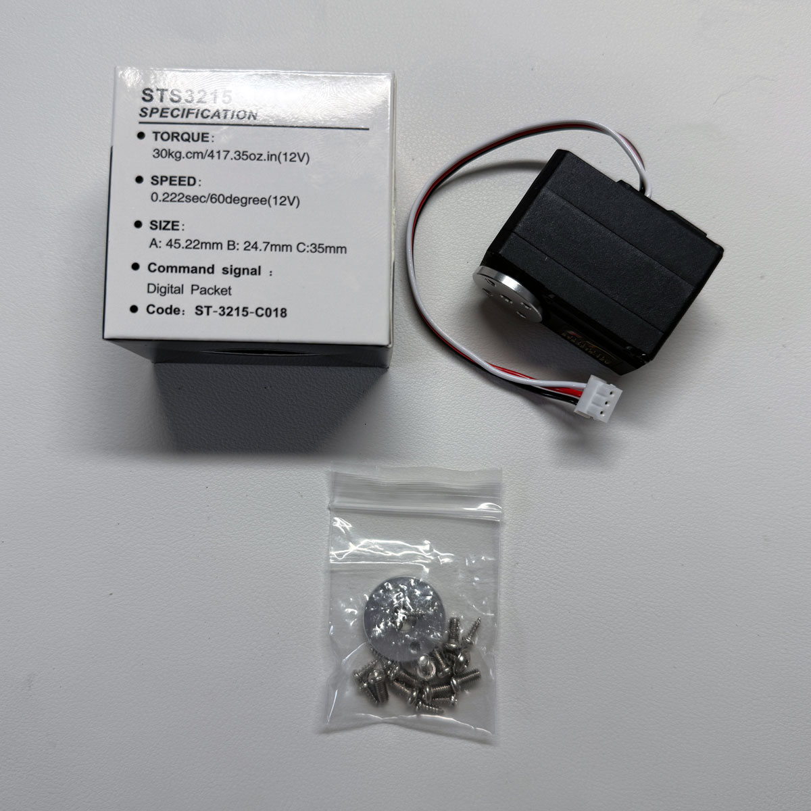
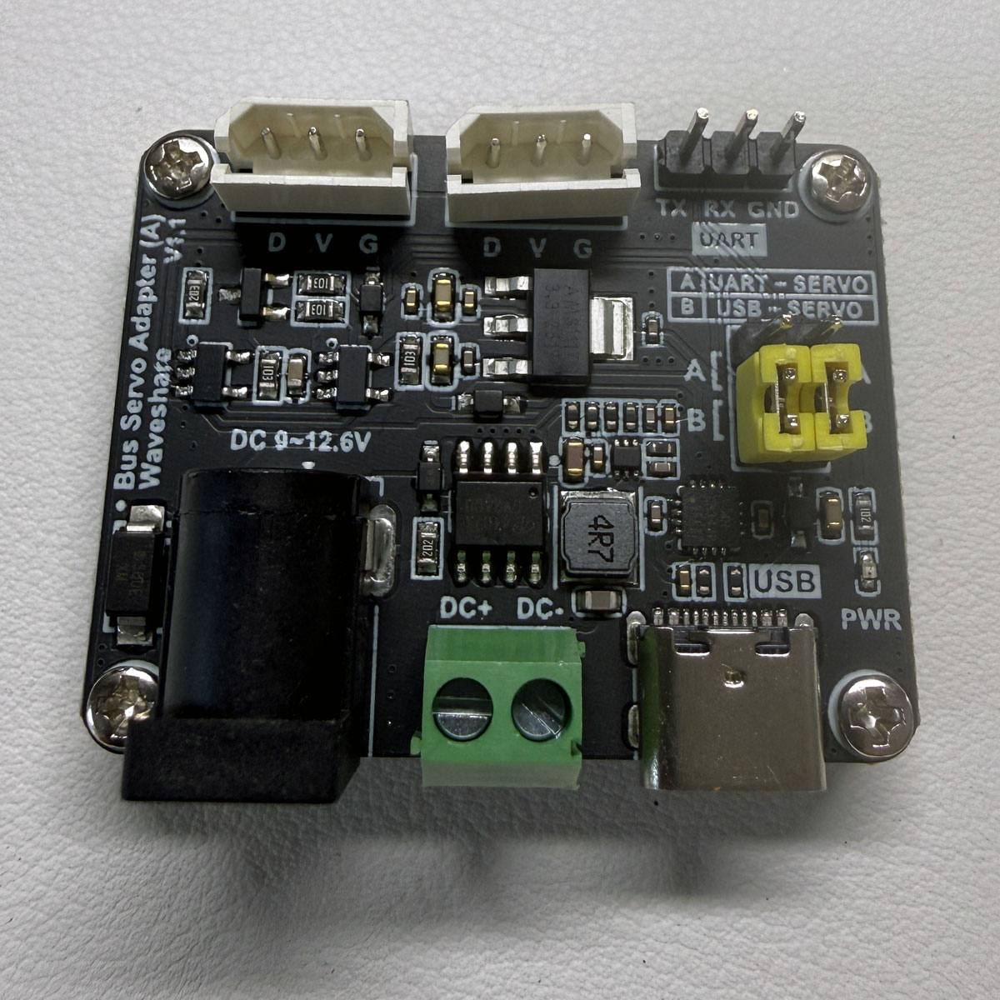
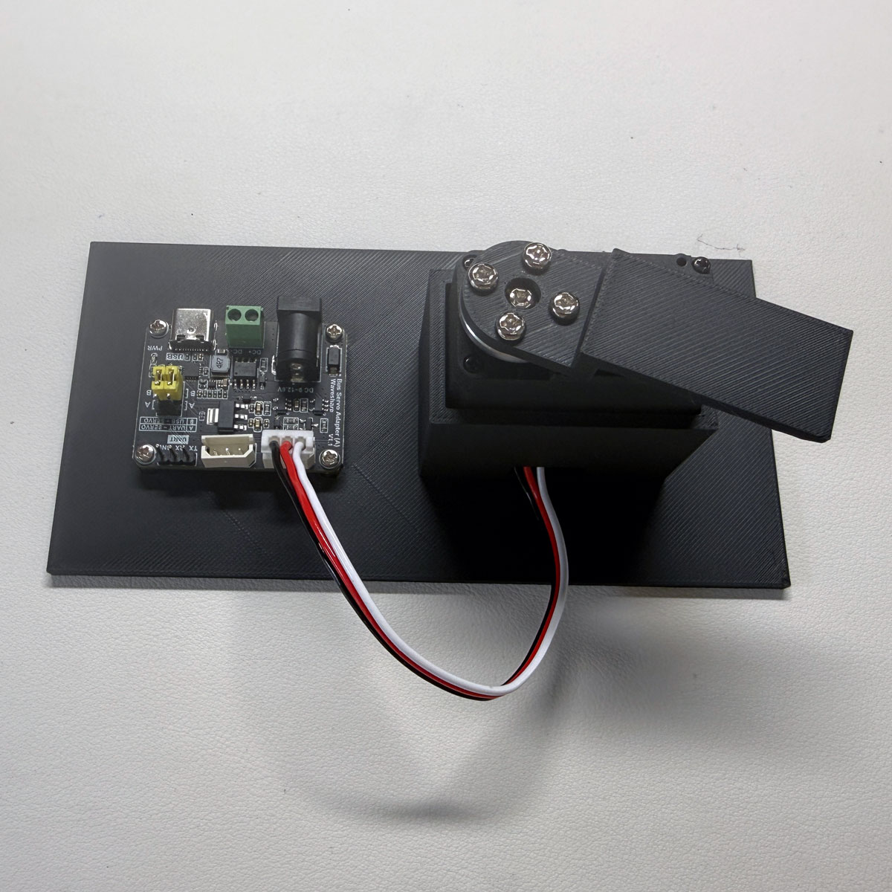
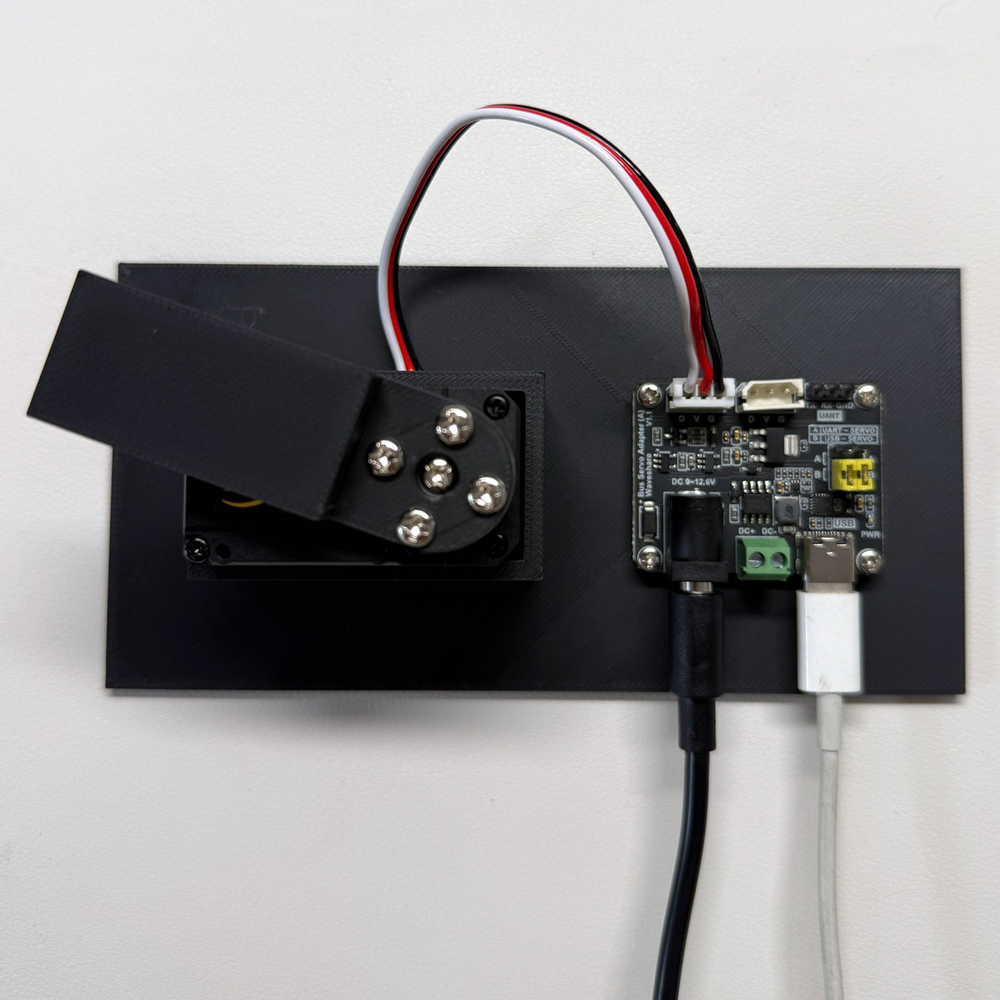
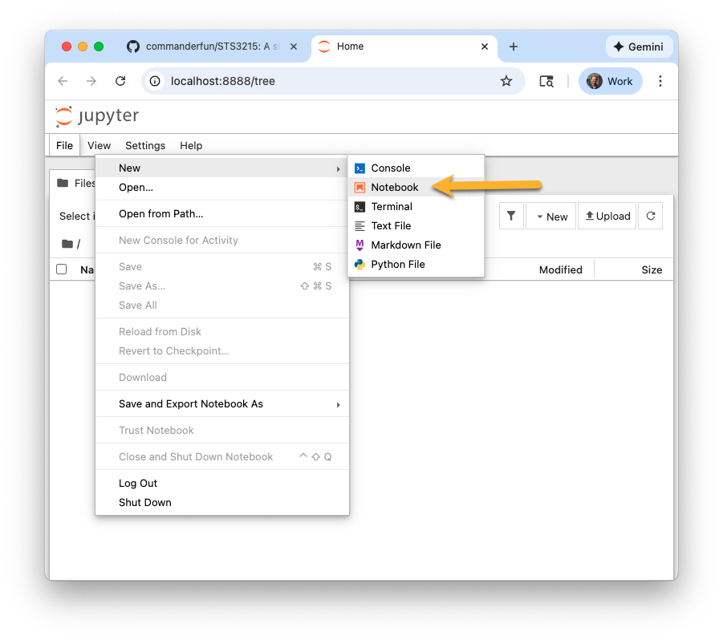

# Feetech STS3215 Servo Tutorial (Part 1)

A multi-part tutorial for controlling the Feetech STS3215 servo (12V-30kg or 7.4V-19kg torque model) with Python and a Waveshare Serial Bus Servo Driver Board.

| Part | Description |
|------|-------------|
| **Part 1** (this file) | Hardware setup and low-level SDK usage |
| **[Part 2](./TUTORIAL_SERVO_CLASS.md)** | Using the high-level `Servo` class for simplified control |
| **[Part 3](./TUTORIAL_TELEOPERATION.md)** | Teleoperation: mirroring one servo's movement to another |
| **[Part 4](./TUTORIAL_DAISY_CHAIN.md)** | Daisy chaining: controlling multiple servos from one board |

## Table of Contents

- [Hardware Requirements](#hardware-requirements)
- [Photos](#photos)
- [Environment Setup](#environment-setup)
- [Register Address Reference](./REGISTER_REFERENCE.md)
- [Tutorial Steps](#tutorial-steps)
  - [Step 0: Start a Jupyter Notebook](#step-0-start-a-jupyter-notebook)
  - [Step 1: Connect Hardware and Find Serial Port](#step-1-connect-your-hardware-and-find-serial-port)
  - [Step 2: Connect to your Servo and Ping It](#step-2-connect-to-your-servo-and-ping-it)
  - [Step 3: Read Servo Status and Current Position](#step-3-read-servo-status-and-current-position)
  - [Step 4: Enable Torque and Move to a Goal Position](#step-4-enable-torque-and-move-to-a-goal-position)
  - [Step 5: Control Movement Speed and Acceleration](#step-5-control-movement-speed-and-acceleration)
  - [Step 6: Read Load/Torque and Monitor Movement](#step-6-read-loadtorque-and-monitor-movement)
  - [Step 7: Read Error Status Codes](#step-7-read-error-status-codes)
  - [Step 8: Disable Torque and Close the Port](#step-8-disable-torque-and-close-the-port)
  - [Step 9: Wheel/Motor Mode (Continuous Rotation)](#step-9-wheelmotor-mode-continuous-rotation)
  - [Step 10: Switch Back to Servo Mode](#step-10-switch-back-to-servo-mode)
  - [Step 11: Clean Shutdown](#step-11-clean-shutdown)
- [Quick Reference](#quick-reference)
- [Part 2: Using the Servo Class](./TUTORIAL_SERVO_CLASS.md)

---

## Hardware Requirements

- Feetech STS3215 servo (12V 30kg torque model) or (7.4V 19kg torque model)
- Waveshare Serial Bus Servo Driver Board
- 12V power supply (at least 2A recommended) or 7.4V power supply
- USB-C cable
- Mac or PC computer

### Optional Hardware

If you have a 3D printer it's helpful to print the [Servo Test Stand](./photos/Servo-Stand.stl) and [Paddle](./photos/Servo-Paddle.stl). You can mount the servo and driver board in the stand to keep everything supported and organized while testing. The paddle helps you see the servo's rotation while testing.

## Photos

<table>
  <tr>
    <td><a href="photos/STS3215-12V.jpg"></a></td>
    <td><a href="photos/waveshare-board.jpg"></a></td>
  </tr>
  <tr>
    <td><a href="photos/12V-power-supply.jpg"></a></td>
    <td><a href="photos/servo-stand-00.jpg"></a></td>
  </tr>
  <tr>
    <td><a href="photos/servo-stand-01.jpg"></a></td>
    <td><a href="photos/servo-stand-02.jpg"></a></td>
  </tr>
</table>

## Environment Setup

Choose either **Conda** or **uv** to set up your Python environment.

### Option A: Conda

```bash
# Create and activate environment
conda create -n servo-tutorial python=3.11 -y
conda activate servo-tutorial

# Install packages
conda install -c conda-forge pyserial jupyter -y
pip install ftservo-python-sdk
```

### Option B: uv

```bash
# Create and activate environment
uv venv --python 3.11
source .venv/bin/activate

# Install packages
uv pip install pyserial jupyter ftservo-python-sdk
```

### ⚠️ Packages to Avoid

- **`feetech-servo-sdk`** - Stripped-down version lacking helper functions. Causes conflicts if installed alongside `ftservo-python-sdk`.
- **`scservo-sdk`** - Does not exist on PyPI.

---

## Register Address Reference

See **[REGISTER_REFERENCE.md](./REGISTER_REFERENCE.md)** for the full register address tables (EEPROM, RAM, and common operations quick reference).

---

## Tutorial Steps

### Step 0: Start a Jupyter Notebook

Create a working directory for this tutorial and launch a Jupyter Notebook from your activated environment:

```bash
cd ~/Documents
mkdir servo-tutorial
cd servo-tutorial
jupyter notebook
```

This will open a browser window. Choose **File > New > Notebook** to launch a new Python 3 notebook and follow along with the tutorial steps below.

<a href="photos/jupyter-01.png"></a>

#### Verify Installation

Run this in your first notebook cell to verify the SDK is installed correctly:

```python
from scservo_sdk import sms_sts, PortHandler

print("sms_sts methods available:")
print("  WheelMode:", hasattr(sms_sts, 'WheelMode'))
print("  WriteSpec:", hasattr(sms_sts, 'WriteSpec'))
print("  WritePosEx:", hasattr(sms_sts, 'WritePosEx'))
```

Expected output:
```
sms_sts methods available:
  WheelMode: True
  WriteSpec: True
  WritePosEx: True
```

---

### Step 1: Connect Your Hardware and Find Serial Port

#### Hardware Setup

1. **Connect the servo to the driver board**: Plug the STS3215 servo's 4-pin cable into one of the two input connectors on the servo and the other end to one of the servo ports on the Waveshare Servo Driver Board. I used the connector on the top-left of the board. See photos above.

2. **Power the driver board**: Connect your 12V or 7.4V power supply to the driver board's power input.

3. **Connect to your computer**: Use a USB cable to connect the Waveshare board to your computer. I used a USB-C to USB-C cable. Depending on your computer you may need a USB-C to USB-A cable.

#### Find the Serial Port

Run this code in your next notebook cell to find the serial port of your Waveshare board.

```python
import serial.tools.list_ports

# List all available serial ports
ports = serial.tools.list_ports.comports()

print("Available serial ports:")
for port in ports:
    print(f"  {port.device}")
    print(f"    Description: {port.description}")
    print(f"    Manufacturer: {port.manufacturer}")
    print()
```

You'll see a few available ports in the output. Look for the port with a prefix like `/dev/cu.usbmodem...` - that's your Waveshare board.

Run a notebook cell to set a variable and save your serial port for use throughout the steps in this tutorial.

```python
SERIAL_PORT = '/dev/cu.usbmodemXXXXX'  # Replace with your actual port
print(f"Using serial port: {SERIAL_PORT}")
```

---

### Step 2: Connect to your Servo and Ping It

```python
from scservo_sdk import sms_sts, PortHandler

# Configuration
BAUDRATE = 1000000
SERVO_ID = 1

# Initialize the port handler and servo handler
port_handler = PortHandler(SERIAL_PORT)
servo = sms_sts(port_handler)

# Open the serial port
if port_handler.openPort():
    print("✓ Port opened successfully")
else:
    print("✗ Failed to open port")
    
# Set the baud rate
if port_handler.setBaudRate(BAUDRATE):
    print(f"✓ Baud rate set to {BAUDRATE}")
else:
    print("✗ Failed to set baud rate")

# Ping the servo to check communication
model_number, comm_result, error = servo.ping(SERVO_ID)

if comm_result == 0:  # COMM_SUCCESS
    print(f"✓ Servo ID {SERVO_ID} found!")
    print(f"  Model number: {model_number}")
else:
    print(f"✗ Failed to ping servo")
```

Expected output:
```
✓ Port opened successfully
✓ Baud rate set to 1000000
✓ Servo ID 1 found!
  Model number: 777
```

---

### Step 3: Read Servo Status and Current Position

```python
# Register addresses
ADDR_PRESENT_POSITION = 56
ADDR_PRESENT_VOLTAGE = 62
ADDR_PRESENT_TEMPERATURE = 63
ADDR_MOVING = 66
ADDR_TORQUE_ENABLE = 40

# Read current position (2 bytes)
position, comm_result, error = servo.read2ByteTxRx(SERVO_ID, ADDR_PRESENT_POSITION)
if comm_result == 0:
    degrees = position * 360 / 4096  # Convert to degrees
    print(f"Current Position: {position} (raw) = {degrees:.1f}°")
else:
    print(f"Failed to read position")

# Read voltage (1 byte)
voltage_raw, comm_result, error = servo.read1ByteTxRx(SERVO_ID, ADDR_PRESENT_VOLTAGE)
if comm_result == 0:
    voltage = voltage_raw * 0.1  # Convert to volts
    print(f"Voltage: {voltage:.1f}V")
else:
    print(f"Failed to read voltage")

# Read temperature (1 byte)
temp, comm_result, error = servo.read1ByteTxRx(SERVO_ID, ADDR_PRESENT_TEMPERATURE)
if comm_result == 0:
    print(f"Temperature: {temp}°C")
else:
    print(f"Failed to read temperature")

# Read torque enable status (1 byte)
torque_enabled, comm_result, error = servo.read1ByteTxRx(SERVO_ID, ADDR_TORQUE_ENABLE)
if comm_result == 0:
    print(f"Torque Enabled: {'Yes' if torque_enabled else 'No'}")
else:
    print(f"Failed to read torque status")

# Read moving status (1 byte)
moving, comm_result, error = servo.read1ByteTxRx(SERVO_ID, ADDR_MOVING)
if comm_result == 0:
    print(f"Moving: {'Yes' if moving else 'No'}")
else:
    print(f"Failed to read moving status")
```

Expected output (your position, voltage and temperature may be different):
```
Current Position: 2048 (raw) = 180.0°
Voltage: 12.3V
Temperature: 33°C
Torque Enabled: No
Moving: No
```

**Tip**: Try physically rotating the servo horn (paddle) a little bit by hand and re-run the cell above - the position value should change! (You can rotate by hand because torque is currently disabled.) Note: It may take a little more force than expected to rotate the 12V version servo by hand. The 7.4V version will be easier.

---

### Step 4: Enable Torque and Move to a Goal Position

```python
# Register addresses
ADDR_TORQUE_ENABLE = 40
ADDR_GOAL_POSITION = 42

# Enable torque
servo.write1ByteTxRx(SERVO_ID, ADDR_TORQUE_ENABLE, 1)
print("✓ Torque enabled - servo is now holding position")

# Move to position (2048 = 180°)
move_to = 2048
degrees = move_to * 360 / 4096  # Convert to degrees
# WritePosEx(ID, Position, Speed, Acceleration)
servo.WritePosEx(SERVO_ID, move_to, 1000, 50)
print(f"✓ Moving to position ({move_to} = {degrees}°)")
```

The servo horn (paddle) should move when you run the code above with the expected output below (unless it was already in the center position of 2048 = 180°).

```
✓ Torque enabled - servo is now holding position
✓ Moving to position (2048 = 180°)
```

When torque is enabled the servo holds its position after moving and resists force up to it's rated torque value.

Now try a few different values between 0 and 4095 for the move_to position and re-run the code above.

**Position values to try**:
- `0` = 0°
- `1024` = 90°
- `2048` = 180° (center)
- `3072` = 270°
- `4095` = 360°

---

### Step 5: Control Movement Speed and Acceleration

Run the code below to experiment with speed and acceleration.

```python
# Parameter ranges:
#   position: 0-4095 (0°-360°, center = 2048)
#   speed:    0-3400 (0 = max speed, otherwise steps/second)
#   acc:      0-254  (0 = instant, higher = smoother ramp)

# Move slowly with smooth acceleration
# WritePosEx(ID, Position, Speed, Acceleration)
servo.WritePosEx(SERVO_ID, 1024, 500, 100)  # Slow, smooth
print("✓ Moving slowly to 90°")

import time
time.sleep(3)

# Move quickly with instant acceleration
servo.WritePosEx(SERVO_ID, 3072, 2000, 0)  # Fast, instant
print("✓ Moving quickly to 270°")
```

**Experiment with a few different values for each**:
- `speed = 100` (very slow)
- `speed = 1000` (medium)
- `speed = 2000` (fast)
- `acceleration = 0` (instant start/stop)
- `acceleration = 100` (very smooth ramp)

---

### Step 6: Read Load/Torque and Monitor Movement

```python
import time

# Register addresses
ADDR_PRESENT_POSITION = 56
ADDR_PRESENT_LOAD = 60
ADDR_PRESENT_CURRENT = 69
ADDR_MOVING = 66

def read_servo_status():
    """Read and display current servo status"""
    # Read position
    position, _, _ = servo.read2ByteTxRx(SERVO_ID, ADDR_PRESENT_POSITION)
    degrees = position * 360 / 4096
    
    # Read load (bits 0-9 = magnitude, bit 10 = direction)
    load_raw, _, _ = servo.read2ByteTxRx(SERVO_ID, ADDR_PRESENT_LOAD)
    load_magnitude = load_raw & 0x3FF  # Lower 10 bits
    load_direction = "CW" if load_raw & 0x400 else "CCW"  # Bit 10
    load_percent = load_magnitude / 1000 * 100
    
    # Read current draw
    current_raw, _, _ = servo.read2ByteTxRx(SERVO_ID, ADDR_PRESENT_CURRENT)
    current_ma = current_raw * 6.5  # Convert to milliamps
    
    # Read moving status
    moving, _, _ = servo.read1ByteTxRx(SERVO_ID, ADDR_MOVING)
    
    print(f"Position: {degrees:6.1f}° | Load: {load_percent:5.1f}% {load_direction} | Current: {current_ma:6.1f}mA | Moving: {'Yes' if moving else 'No'}")

# Move to a position and monitor
print("Moving servo and monitoring status...\n")

# Start a move
servo.WritePosEx(SERVO_ID, 1024, 500, 50)

# Monitor for 2 seconds
for i in range(20):
    read_servo_status()
    time.sleep(0.1)

print("\nDone!")
```

**Tip**: While the servo is holding position, try gently pushing against the horn (paddle) with your finger - you should see the load percentage increase as it encounters some resistance.

---

### Step 7: Read Error Status Codes

```python
# Register addresses
ADDR_SERVO_STATUS = 65
ADDR_PRESENT_VOLTAGE = 62
ADDR_PRESENT_TEMPERATURE = 63
ADDR_MAX_TEMP_LIMIT = 13
ADDR_MAX_VOLTAGE_LIMIT = 14
ADDR_MIN_VOLTAGE_LIMIT = 15

# Error status bitmask definitions
ERROR_FLAGS = {
    0: "Voltage Error",
    1: "Sensor Error", 
    2: "Temperature Error",
    3: "Current Error",
    5: "Overload Error",
}

# Read servo status register
status, comm_result, error = servo.read1ByteTxRx(SERVO_ID, ADDR_SERVO_STATUS)

if comm_result == 0:
    print("=== Servo Error Status ===\n")
    
    if status == 0:
        print("✓ No errors - servo is healthy!")
    else:
        print(f"⚠ Status byte: {status} (binary: {bin(status)})\n")
        print("Active errors:")
        for bit, name in ERROR_FLAGS.items():
            if status & (1 << bit):
                print(f"  ✗ {name}")
else:
    print(f"Failed to read status")

# Read current conditions for context
print("\n=== Current Conditions ===\n")

voltage_raw, _, _ = servo.read1ByteTxRx(SERVO_ID, ADDR_PRESENT_VOLTAGE)
temp, _, _ = servo.read1ByteTxRx(SERVO_ID, ADDR_PRESENT_TEMPERATURE)
max_temp, _, _ = servo.read1ByteTxRx(SERVO_ID, ADDR_MAX_TEMP_LIMIT)
max_volt, _, _ = servo.read1ByteTxRx(SERVO_ID, ADDR_MAX_VOLTAGE_LIMIT)
min_volt, _, _ = servo.read1ByteTxRx(SERVO_ID, ADDR_MIN_VOLTAGE_LIMIT)

print(f"Voltage:     {voltage_raw * 0.1:.1f}V  (limits: {min_volt * 0.1:.1f}V - {max_volt * 0.1:.1f}V)")
print(f"Temperature: {temp}°C  (limit: {max_temp}°C)")
```

Expected output if servo is healthy (yours may vary slightly):

```
=== Servo Error Status ===

✓ No errors - servo is healthy!

=== Current Conditions ===

Voltage:     12.3V  (limits: 4.0V - 14.0V)
Temperature: 36°C  (limit: 70°C)
```

---

### Step 8: Disable Torque and Close the Port

```python
ADDR_TORQUE_ENABLE = 40

# Disable torque - servo will go limp
servo.write1ByteTxRx(SERVO_ID, ADDR_TORQUE_ENABLE, 0)
print("✓ Torque disabled")

# Close the port
port_handler.closePort()
print("✓ Port closed")
```

**Protect your servo**: Always disable torque and close the port when you're done. This:
- Prevents the servo from holding position and drawing current unnecessarily
- Releases the serial port so other programs can use it
- Allows you to safely reposition the servo by hand

---

### Step 9: Wheel/Motor Mode (Continuous Rotation)

Wheel mode allows the servo to rotate continuously like a motor - useful for wheels, conveyors, or anything that needs to spin.

```python
from scservo_sdk import sms_sts, PortHandler

# Reconnect to servo
# SERIAL_PORT = '/dev/cu.usbmodemXXXXX'  # Replace with your port
BAUDRATE = 1000000
SERVO_ID = 1

port_handler = PortHandler(SERIAL_PORT)
servo = sms_sts(port_handler)

port_handler.openPort()
port_handler.setBaudRate(BAUDRATE)
print("✓ Connected to servo")

# Enable wheel mode
servo.WheelMode(SERVO_ID)
print("✓ Wheel mode enabled")

# Spin using WriteSpec(ID, Speed, Acceleration)
# Speed: positive = one direction, negative = other direction
speed = 500
acceleration = 50
servo.WriteSpec(SERVO_ID, speed, acceleration)
print(f"✓ Spinning at speed {speed}")
```

#### Controlling Wheel Mode

```python
import time

# Change direction - use negative speed for opposite direction
print("--- Spinning CCW (negative speed) ---")
servo.WriteSpec(SERVO_ID, -500, 50)
time.sleep(2)

# Speed up
print("--- Faster CW ---")
servo.WriteSpec(SERVO_ID, 1500, 50)
time.sleep(2)

# Slow down
print("--- Slower CW ---")
servo.WriteSpec(SERVO_ID, 200, 50)
time.sleep(2)

# Stop the motor
print("--- Stopping ---")
servo.WriteSpec(SERVO_ID, 0, 50)
print("✓ Motor stopped")
```

---

### Step 10: Switch Back to Servo Mode

```python
# Register addresses
ADDR_MIN_ANGLE_LIMIT = 9
ADDR_MAX_ANGLE_LIMIT = 11
ADDR_MODE = 33
ADDR_TORQUE_ENABLE = 40

# Disable torque to change EEPROM settings
servo.write1ByteTxRx(SERVO_ID, ADDR_TORQUE_ENABLE, 0)
print("✓ Torque disabled")

# Restore angle limits (0-4095 = full 360° range)
servo.write2ByteTxRx(SERVO_ID, ADDR_MIN_ANGLE_LIMIT, 0)
servo.write2ByteTxRx(SERVO_ID, ADDR_MAX_ANGLE_LIMIT, 4095)
print("✓ Angle limits restored (0-4095)")

# Set mode back to 0 (Position servo mode)
servo.write1ByteTxRx(SERVO_ID, ADDR_MODE, 0)
print("✓ Mode set to 0 (position control)")

# Enable torque
servo.write1ByteTxRx(SERVO_ID, ADDR_TORQUE_ENABLE, 1)
print("✓ Torque enabled")

# Test by moving to center position
servo.WritePosEx(SERVO_ID, 2048, 1000, 50)
print("✓ Moving to center position (2048)")
```

Expected output:

```
✓ Torque disabled
✓ Angle limits restored (0-4095)
✓ Mode set to 0 (position control)
✓ Torque enabled
✓ Moving to center position (2048)
```

---

### Step 11: Clean Shutdown

```python
ADDR_TORQUE_ENABLE = 40

# Disable torque and close port
servo.write1ByteTxRx(SERVO_ID, ADDR_TORQUE_ENABLE, 0)
print("✓ Torque disabled")

port_handler.closePort()
print("✓ Port closed")

print("\n" + "="*50)
print("TUTORIAL COMPLETE!")
print("="*50)
```

Expected output:

```
✓ Torque disabled
✓ Port closed

==================================================
TUTORIAL COMPLETE!
==================================================
```

---

## Quick Reference

### Basic Connection

```python
from scservo_sdk import sms_sts, PortHandler

port_handler = PortHandler('/dev/cu.usbmodemXXXX') # Replace with your port
servo = sms_sts(port_handler)
port_handler.openPort()
port_handler.setBaudRate(1000000) # 1000000 is default baud rate
```

### Position Control (Servo Mode)

```python
servo.WritePosEx(SERVO_ID, position, speed, acceleration)
# position: 0-4095 (0°-360°, center = 2048)
# speed:    0-3400 (0 = max speed, otherwise steps/second)
# acc:      0-254  (0 = instant, higher = smoother ramp)
```

### Continuous Rotation Mode (Wheel Mode)

```python
servo.WheelMode(SERVO_ID)
servo.WriteSpec(SERVO_ID, speed, acceleration)
# speed: positive=CW, negative=CCW, 0=stop
```

### Reading Servo Status

```python
position, result, error = servo.read2ByteTxRx(SERVO_ID, 56)  # Position
voltage, result, error = servo.read1ByteTxRx(SERVO_ID, 62)   # Voltage
temp, result, error = servo.read1ByteTxRx(SERVO_ID, 63)      # Temperature
load, result, error = servo.read2ByteTxRx(SERVO_ID, 60)      # Load
status, result, error = servo.read1ByteTxRx(SERVO_ID, 65)    # Error status
```

### Best Practices

1. Disable torque before changing EEPROM settings
2. Always close the port when done
3. Check error status for troubleshooting

---

## Part 2: Using the Servo Class

Ready to simplify your servo code? Continue to **[Part 2: Servo Class Tutorial](./TUTORIAL_SERVO_CLASS.md)** to learn how to use the high-level `Servo` class wrapper.

The `Servo` class provides:
- Auto-detection of serial ports
- Simple methods like `position()`, `voltage()`, `temperature()`
- Synchronous movement with `move_sync()` and `move_sequence()`
- Automatic torque and mode management

```python
from servo import Servo

s = Servo()
s.ping()
s.move_to(2048)  # Move to center
pos, deg = s.position()
s.disable_torque()
s.close_bus()
```

---

## License

This tutorial is provided as-is for educational purposes. The Feetech STS3215 servo and related SDKs are products of Feetech RC Model Co., Ltd.
