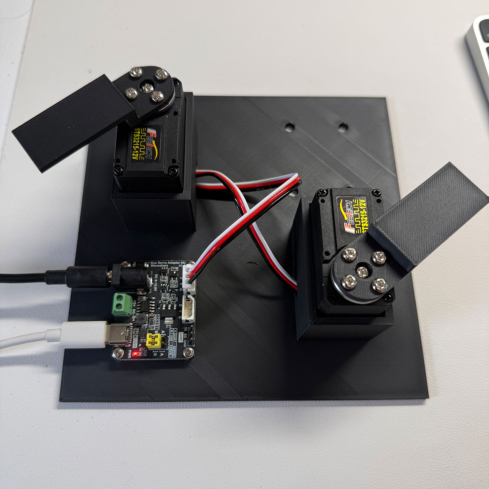
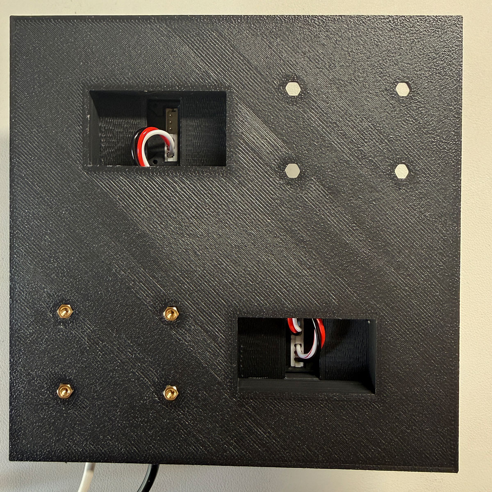

# Daisy Chain Tutorial (Part 4)

Control multiple servos from a single driver board by chaining them together on one serial bus.

## Table of Contents

- [Prerequisites](#prerequisites)
- [How Daisy Chaining Works](#how-daisy-chaining-works)
- [Hardware Setup](#hardware-setup)
- [Tutorial Steps](#tutorial-steps)
  - [Step 1: Assign Unique IDs](#step-1-assign-unique-ids)
  - [Step 2: Connect to Both Servos](#step-2-connect-to-both-servos)
  - [Step 3: Verify Both Servos](#step-3-verify-both-servos)
  - [Step 4: Read Status from Both](#step-4-read-status-from-both)
  - [Step 5: Independent Control](#step-5-independent-control)
  - [Step 6: Coordinated Movements](#step-6-coordinated-movements)
  - [Step 7: Monitoring Both Servos](#step-7-monitoring-both-servos)
  - [Step 8: Clean Shutdown](#step-8-clean-shutdown)
- [Complete Example](#complete-example)

---

## Prerequisites

Before starting this tutorial:

1. Complete [Part 1 (README.md)](./README.md) and [Part 2 (TUTORIAL_SERVO_CLASS.md)](./TUTORIAL_SERVO_CLASS.md)
2. Have **two** STS3215 servos
3. Have **one** Waveshare Serial Bus Servo Driver Board
4. One power supply and one USB connection to your computer
5. Ensure `servo.py` is in your working directory

---

## How Daisy Chaining Works

Each STS3215 servo has **two identical 4-pin connectors** on its body — they are electrically connected in parallel inside the servo. This lets you pass the serial bus signal through one servo to the next, forming a chain.

```
Driver Board → Servo (ID=1) → Servo (ID=2) → ...
```

All servos share the same serial bus (one USB connection, one serial port). The driver distinguishes between them using their **servo ID** — a unique number stored in each servo's EEPROM. Every servo on a bus must have a different ID.

**Daisy chaining vs. teleoperation (Part 3)**

| | Daisy Chain (Part 4) | Teleoperation (Part 3) |
|--|----------------------|------------------------|
| Driver boards | 1 | 2 |
| USB connections | 1 | 2 |
| Serial ports | 1 | 2 |
| Servo IDs | Must be unique | Can be the same |
| Best for | Coordinated multi-servo control | Low-latency leader/follower |

---

## Hardware Setup

### Dual Servo Test Stand

The photos below show a 3D printed dual servo test stand ([`Servo-Stand-Dual.stl`](./Servo-Stand-Dual.stl)) with two servo slots and a board mount. Print one and use it to keep everything organized while following this tutorial.

<table>
  <tr>
    <td><a href="photos/servo-stand-dual-01.jpg"></a></td>
    <td><a href="photos/servo-stand-dual-02.jpg"></a></td>
  </tr>
</table>

### Wiring

1. **Power and connect the driver board** to your computer via USB and to your 12V or 7.4V power supply.
2. **Connect the driver board to Servo 1** using a 4-pin cable into either of Servo 1's two connectors.
3. **Connect Servo 1 to Servo 2** using a second 4-pin cable between Servo 1's remaining connector and either connector on Servo 2.

The cable order is: **Driver Board → Servo 1 → Servo 2**

Both servos are now on the same serial bus.

---

## Tutorial Steps

### Step 1: Assign Unique IDs

Both servos ship with the default ID of `1`. Before chaining them together, you must give one of them a different ID. **Do this with only one servo connected at a time** — if two servos with the same ID are on the bus simultaneously, they will both respond to commands and corrupt each other's replies.

#### Set the second servo's ID

Connect only the servo you want to reassign, then run:

```python
from servo import Servo

# Connect to the servo at its current default ID
s = Servo(servo_id=1)
s.ping()

# Confirm its current ID
print(f"Current ID: {s.get_id()}")

# Change to ID 2 (saved to EEPROM, survives power cycles)
s.set_id(2)
print(f"New ID: {s.get_id()}")

# Clean up
s.disable_torque()
s.close_bus()
```

**Power cycle the servo**, then verify the new ID persisted:

```python
s = Servo(servo_id=2)
s.ping()
print(f"ID after power cycle: {s.get_id()}")  # Should print 2

s.disable_torque()
s.close_bus()
```

You now have:
- **Servo A**: ID=1 (default, untouched)
- **Servo B**: ID=2 (just set)

Connect both servos in the chain before continuing.

---

### Step 2: Connect to Both Servos

With both servos chained together, create two `Servo` instances. They automatically share a single serial connection — the port is opened once and reused.

```python
from servo import Servo

s1 = Servo(servo_id=1)
s2 = Servo(servo_id=2)

print(f"s1 port: {s1.SERIAL_PORT}")
print(f"s2 port: {s2.SERIAL_PORT}")
print(f"Same connection: {s1._port_handler is s2._port_handler}")
```

Expected output:
```
s1 port: /dev/cu.usbmodem5AE60543861
s2 port: /dev/cu.usbmodem5AE60543861
Same connection: True
```

Both instances share the same port handler — only one serial connection is open.

---

### Step 3: Verify Both Servos

Ping both servos to confirm they are responding on the bus.

```python
s1.ping()
s2.ping()

print(f"Servo 1 ID: {s1.get_id()}")
print(f"Servo 2 ID: {s2.get_id()}")
```

Expected output:
```
✓ Serial comm port: /dev/cu.usbmodem5AE60543861
✓ Successfully pinged servo ID 1
✓ Model number: 777
✓ Serial comm port: /dev/cu.usbmodem5AE60543861
✓ Successfully pinged servo ID 2
✓ Model number: 777
Servo 1 ID: 1
Servo 2 ID: 2
```

---

### Step 4: Read Status from Both

```python
def print_status(servo, label):
    pos, deg = servo.position()
    print(f"{label}:")
    print(f"  Position:    {pos} ({deg:.1f}°)")
    print(f"  Voltage:     {servo.voltage():.1f}V")
    print(f"  Temperature: {servo.temperature()}°C")
    print(f"  Torque on:   {servo.torque_enabled()}")
    print(f"  Healthy:     {servo.is_healthy()}")

print_status(s1, "Servo 1")
print()
print_status(s2, "Servo 2")
```

**Tip**: Try rotating each servo horn by hand and re-run — the position values should change independently.

---

### Step 5: Independent Control

Command each servo to a different position.

```python
import time

# Move each servo to a different position independently
print("Moving to different positions...")
s1.move_to(1024)   # Servo 1 → 90°
s2.move_to(3072)   # Servo 2 → 270°
time.sleep(2)

# Move back to center
print("Both to center...")
s1.move_to(2048)
s2.move_to(2048)
time.sleep(2)

print("Done!")
```

The commands are sent sequentially over the shared bus — each takes a few milliseconds — so the servos will start moving at nearly the same time.

---

### Step 6: Coordinated Movements

#### Synchronized (same direction)

```python
import time

positions = [512, 2048, 3584, 2048]  # 45°, 180°, 315°, 180°

print("Synchronized sweep...")
for pos in positions:
    s1.move_to(pos)
    s2.move_to(pos)
    time.sleep(1.5)

print("Done!")
```

#### Mirrored (opposite directions)

```python
import time

# Move in opposite directions simultaneously
print("Mirrored sweep...")

s1.move_to(1024)   # 90°
s2.move_to(3072)   # 270°
time.sleep(2)

s1.move_to(3072)   # 270°
s2.move_to(1024)   # 90°
time.sleep(2)

s1.move_to(2048)   # center
s2.move_to(2048)   # center
time.sleep(2)

print("Done!")
```

#### Sequential (one finishes before the next starts)

```python
import time

print("Sequential moves...")

# move_sync() blocks until the servo reaches the target
s1.move_sync(512)    # wait for s1 to reach 45°
s2.move_sync(3584)   # then move s2 to 315°
s1.move_sync(2048)   # then s1 back to center
s2.move_sync(2048)   # then s2 back to center

print("Done!")
```

---

### Step 7: Monitoring Both Servos

Poll both servos in a loop to watch them move in real time.

```python
import time

def print_both(s1, s2):
    p1, d1 = s1.position()
    p2, d2 = s2.position()
    print(f"  S1: {d1:6.1f}°  {'moving' if s1.moving() else 'stopped':7s} | "
          f"  S2: {d2:6.1f}°  {'moving' if s2.moving() else 'stopped':7s}")

# Start a move on each servo then monitor for 3 seconds
s1.move_to(512, speed=500)
s2.move_to(3584, speed=500)

print("Monitoring (3 seconds)...")
start = time.perf_counter()
while time.perf_counter() - start < 3:
    print_both(s1, s2)
    time.sleep(0.1)

print("Done!")
```

---

### Step 8: Clean Shutdown

Always disable torque before closing the bus.

```python
s1.disable_torque()
s2.disable_torque()
s1.close_bus()   # closes the shared connection for both
print("✓ Done")
```

---

## Complete Example

A full script you can run in a single notebook cell:

```python
from servo import Servo
import time

# === Connect ===
print("Connecting...")
s1 = Servo(servo_id=1)
s2 = Servo(servo_id=2)

s1.ping()
s2.ping()

# === Status ===
print(f"\nServo 1: ID={s1.get_id()}, {s1.position()[1]:.1f}°, {s1.voltage():.1f}V")
print(f"Servo 2: ID={s2.get_id()}, {s2.position()[1]:.1f}°, {s2.voltage():.1f}V")

# === Center both ===
print("\nCentering both servos...")
s1.move_to(2048)
s2.move_to(2048)
time.sleep(2)

# === Mirrored sweep ===
print("Mirrored sweep...")
s1.move_to(1024)
s2.move_to(3072)
time.sleep(2)

s1.move_to(3072)
s2.move_to(1024)
time.sleep(2)

s1.move_to(2048)
s2.move_to(2048)
time.sleep(2)

# === Synchronized sweep ===
print("Synchronized sweep...")
for pos in [512, 3584, 2048]:
    s1.move_to(pos)
    s2.move_to(pos)
    time.sleep(2)

# === Shutdown ===
print("\nShutting down...")
s1.disable_torque()
s2.disable_torque()
s1.close_bus()
print("✓ Done")
```

---

## Next Steps

With daisy chaining working, some directions to explore:

- **More servos**: Add a third servo (ID=3) to the chain — no hardware changes needed, just another 4-pin cable
- **Sync timing**: Use `move_sync()` on both servos for tighter sequential choreography
- **Status monitoring**: Build a real-time dashboard polling both servos in a loop
- **Wheel mode**: Run both servos as motors simultaneously for a differential drive robot
